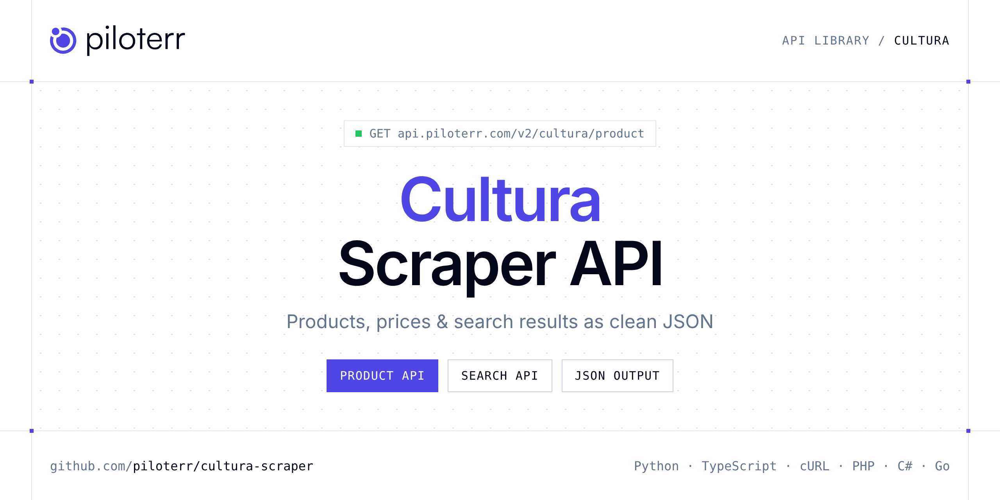

<p align="center">
  <a href="https://www.piloterr.com"></a>
</p>

# Cultura Scraper API

[](https://discord.gg/CFj3ph8aHU) [](https://app.piloterr.com) [](https://app.piloterr.com/openapi) [](LICENSE)

The **Piloterr Cultura Scraper API** lets you extract public data from Cultura as **clean, structured JSON** — no proxies, headless browsers or HTML parsing to maintain. Endpoints available in production:

- **Cultura Product API** — Read one Cultura product from its URL or SKU.
- **Cultura Search API** — Search Cultura by keyword and page through books, games, and culture products.

Use it for price monitoring, assortment tracking, competitor analysis, product research or catalog enrichment.

| Endpoint | Path | Credits | What you get |
|---|---|---|---|
| [Cultura Product API](#cultura-product-api) | `/v2/cultura/product` | 2 | Read one Cultura product from its URL or SKU. You get price, EAN, seller, condition, and stock wording. |
| [Cultura Search API](#cultura-search-api) | `/v2/cultura/search` | 2 | Search Cultura by keyword and page through books, games, and culture products. Cards include title, price, availability, and the product link. |

## Table of contents

- [How it works](#how-it-works)
- [Cultura Product API](#cultura-product-api)
- [Cultura Search API](#cultura-search-api)
- [Code examples in other languages](#code-examples-in-other-languages)
- [Practical use cases](#practical-use-cases)
- [Why Piloterr?](#why-piloterr)
- [FAQ](#faq)
- [Related scrapers](#related-scrapers)
- [Support](#support)

## How it works

1. **Create a free Piloterr account** and copy your API key from the [dashboard](https://app.piloterr.com).
2. **Send a `GET` (or `POST`) request** to `https://api.piloterr.com/v2/...` with the header `x-api-key: YOUR_API_KEY`.
3. **Receive structured JSON** — Piloterr handles rendering, proxies, retries and parsing.

```bash
export PILOTERR_API_KEY="your-api-key"
pip install requests        # Python
# TypeScript: Node.js 18+ (native fetch), run with `npx tsx file.ts`
```

> Every endpoint accepts both `GET` (query string) and `POST` (JSON body with the same fields).

## Cultura Product API

Read one Cultura product from its URL or SKU. You get price, EAN, seller, condition, and stock wording.

`GET | POST https://api.piloterr.com/v2/cultura/product` · **2 credits per request** · [Full reference](https://app.piloterr.com/openapi)

### Request parameters

| Parameter | Type | Required | Description |
|---|---|---|---|
| `query` | string | ✅ | Link of the Cultura product page. |

### Python example

```python
import json
import os
import requests

response = requests.get(
    "https://api.piloterr.com/v2/cultura/product",
    headers={"x-api-key": os.environ["PILOTERR_API_KEY"]},
    params={
        "query": "https://www.cultura.com/p-harry-potter-et-le-prisonnier-d-azkaban-illustre-par-minalima-9782075193993.html",
    },
    timeout=120,
)
response.raise_for_status()
data = response.json()

print(json.dumps(data, indent=2, ensure_ascii=False)[:2000])
```

### TypeScript example

```typescript
type CulturaProduct = {
  ean?: string;
  sku?: string;
  url?: string;
  name?: string;
  badge?: string;
  brand?: string;
  image?: string;
  price?: number;
  images?: string[];
  seller?: string;
  currency?: string;
  condition?: string;
  breadcrumbs?: {
    url?: string;
    name?: string;
  }[];
  description?: string;
  availability?: string;
  contributors?: {
    name?: string;
    role?: string;
  }[];
  price_display?: string;
  favorite_count?: number;
};

const params = new URLSearchParams({
  "query": "https://www.cultura.com/p-harry-potter-et-le-prisonnier-d-azkaban-illustre-par-minalima-9782075193993.html",
});

const response = await fetch(`https://api.piloterr.com/v2/cultura/product?${params}`, {
  headers: { "x-api-key": process.env.PILOTERR_API_KEY! },
});
if (!response.ok) throw new Error(`Piloterr error ${response.status}: ${await response.text()}`);

const data = (await response.json()) as CulturaProduct;

console.log(JSON.stringify(data, null, 2).slice(0, 2000));
```

<details>
<summary><b>POST variant</b></summary>

```http
POST https://api.piloterr.com/v2/cultura/product
x-api-key: YOUR_API_KEY
Content-Type: application/json

{"query": "https://www.cultura.com/p-harry-potter-et-le-prisonnier-d-azkaban-illustre-par-minalima-9782075193993.html"}
```
</details>

### Output example

Example response from the API reference, abridged — real values depend on the page you scrape.

```json
{
  "ean": "9782075193993",
  "sku": "10016146",
  "url": "https://www.cultura.com/p-harry-potter-et-le-prisonnier-d-azkaban-illustre-par-minalima-9782075193993.html",
  "name": "Harry Potter Tome 3 : Harry Potter et le prisonnier d'Azkaban",
  "badge": "Coup de cœur",
  "brand": "J. K. Rowling",
  "image": "https://cdn.cultura.com/media/pim/10016146_10vq8xg2_1_e5a37",
  "price": 42.5,
  "images": [
    "https://cdn.cultura.com/media/pim/10016146_10vq8xg2_1_e5a37",
    "https://cdn.cultura.com/media/pim/10016146_15393428"
  ],
  "seller": "example",
  "currency": "EUR",
  "condition": "Neuf",
  "breadcrumbs": [
    {
      "url": "https://www.cultura.com/",
      "name": "Accueil"
    },
    {
      "url": "https://www.cultura.com/univers-enfant.html",
      "name": "Enfant"
    }
  ],
  "description": "Sublimes illustrations en couleurs et huit prouesses d'ingénierie papier interactives : une édition unique du deuxième tome de la saga Ha…",
  "availability": "en stock Cultura",
  "contributors": [
    {
      "name": "J. K. Rowling",
      "role": "Auteur"
    },
    {
      "name": "Minalima",
      "role": "Illustrateur"
    }
  ],
  "price_display": "42,50 €",
  "favorite_count": 6
}
```

### Response fields

| Field | Type | Description |
|---|---|---|
| `ean` | string |  |
| `sku` | string |  |
| `url` | string |  |
| `name` | string |  |
| `badge` | string |  |
| `brand` | string |  |
| `image` | string |  |
| `price` | number |  |
| `images` | string[] |  |
| `seller` | string |  |
| `currency` | string |  |
| `condition` | string |  |
| `breadcrumbs[]` | object[] |  |
| `breadcrumbs[].url` | string |  |
| `breadcrumbs[].name` | string |  |
| `description` | string |  |
| `availability` | string |  |
| `contributors[]` | object[] |  |
| `contributors[].name` | string |  |
| `contributors[].role` | string |  |
| `price_display` | string |  |
| `favorite_count` | integer |  |

## Cultura Search API

Search Cultura by keyword and page through books, games, and culture products. Cards include title, price, availability, and the product link.

`GET | POST https://api.piloterr.com/v2/cultura/search` · **2 credits per request** · [Full reference](https://app.piloterr.com/openapi)

### Request parameters

| Parameter | Type | Required | Description |
|---|---|---|---|
| `query` | string | ✅ | Words to search for on Cultura, or the search page link. |
| `page` | number | — | Page number, starting at 1. For example, 2 returns the next page of results. |

### Python example

```python
import json
import os
import requests

response = requests.get(
    "https://api.piloterr.com/v2/cultura/search",
    headers={"x-api-key": os.environ["PILOTERR_API_KEY"]},
    params={
        "query": "harry potter",
    },
    timeout=120,
)
response.raise_for_status()
data = response.json()

print(json.dumps(data, indent=2, ensure_ascii=False)[:2000])
```

### TypeScript example

```typescript
type CulturaSearch = {
  results?: {
    sku?: string;
    url?: string;
    name?: string;
    badge?: string;
    brand?: string;
    image?: string;
    price?: number;
    rating?: unknown;
    currency?: string;
    position?: number;
    availability?: string;
    review_count?: unknown;
    price_display?: string;
    new_offers_count?: unknown;
    new_offers_price?: unknown;
    used_offers_count?: unknown;
    used_offers_price?: unknown;
    new_offers_price_display?: unknown;
    used_offers_price_display?: unknown;
  }[];
  pagination?: {
    next?: string;
    page?: number;
    per_page?: number;
    total_pages?: number;
    total_results?: number;
  };
};

const params = new URLSearchParams({
  "query": "harry potter",
});

const response = await fetch(`https://api.piloterr.com/v2/cultura/search?${params}`, {
  headers: { "x-api-key": process.env.PILOTERR_API_KEY! },
});
if (!response.ok) throw new Error(`Piloterr error ${response.status}: ${await response.text()}`);

const data = (await response.json()) as CulturaSearch;

console.log(JSON.stringify(data, null, 2).slice(0, 2000));
```

<details>
<summary><b>POST variant</b></summary>

```http
POST https://api.piloterr.com/v2/cultura/search
x-api-key: YOUR_API_KEY
Content-Type: application/json

{"query": "harry potter"}
```
</details>

### Output example

Example response from the API reference, abridged — real values depend on the page you scrape.

```json
{
  "results": [
    {
      "sku": "13432454",
      "url": "https://www.cultura.com/p-harry-potter-a-l-ecole-des-sorciers-9782075253147.html",
      "name": "Harry Potter à l'école des sorciers",
      "badge": "Précommande",
      "brand": "J. K. Rowling",
      "image": "https://cdn.cultura.com/media/pim/13432454_8wuv0xn9_1_95486",
      "price": 8.95,
      "rating": null,
      "currency": "EUR",
      "position": 1,
      "availability": "Précommande - sortie le 05/11/26",
      "review_count": null,
      "price_display": "8,95 €",
      "new_offers_count": null,
      "new_offers_price": null,
      "used_offers_count": null,
      "used_offers_price": null,
      "new_offers_price_display": null,
      "used_offers_price_display": null
    }
  ],
  "pagination": {
    "next": "https://www.cultura.com/search/results?search_query=harry+potter&page=2",
    "page": 1,
    "per_page": 60,
    "total_pages": 50,
    "total_results": 3371
  }
}
```

### Response fields

| Field | Type | Description |
|---|---|---|
| `results[]` | object[] |  |
| `results[].sku` | string |  |
| `results[].url` | string |  |
| `results[].name` | string |  |
| `results[].badge` | string |  |
| `results[].brand` | string |  |
| `results[].image` | string |  |
| `results[].price` | number |  |
| `results[].rating` | object |  |
| `results[].currency` | string |  |
| `results[].position` | integer |  |
| `results[].availability` | string |  |
| `results[].review_count` | object |  |
| `results[].price_display` | string |  |
| `results[].new_offers_count` | object |  |
| `results[].new_offers_price` | object |  |
| `results[].used_offers_count` | object |  |
| `results[].used_offers_price` | object |  |
| `results[].new_offers_price_display` | object |  |
| `results[].used_offers_price_display` | object |  |
| `pagination` | object |  |
| `pagination.next` | string |  |
| `pagination.page` | integer |  |
| `pagination.per_page` | integer |  |
| `pagination.total_pages` | integer |  |

## Code examples in other languages

Ready-to-run examples live in the [`examples/`](examples) folder. Each one reads your key from the `PILOTERR_API_KEY` environment variable.

| Language | Product | Search |
|---|---|---|
| cURL (Bash) | [`product`](examples/curl/product.sh) | [`search`](examples/curl/search.sh) |
| PHP | [`product`](examples/php/product.php) | [`search`](examples/php/search.php) |
| C# | [`product`](examples/csharp/Product.cs) | [`search`](examples/csharp/Search.cs) |
| Go | [`product`](examples/go/product.go) | [`search`](examples/go/search.go) |
| Java | [`product`](examples/java/ProductExample.java) | [`search`](examples/java/SearchExample.java) |
| Ruby | [`product`](examples/ruby/product.rb) | [`search`](examples/ruby/search.rb) |
| Node.js | [`product`](examples/nodejs/product.mjs) | [`search`](examples/nodejs/search.mjs) |

## Practical use cases

- **Price monitoring** — Track prices, promotions and availability over time to react to competitors.
- **Assortment & catalog tracking** — Follow new products, delisted items and category changes.
- **Competitor analysis** — Benchmark ranges, brands and positioning across retailers.
- **Product research** — Spot best-sellers and trends from search results.
- **Catalog enrichment** — Pull titles, images and attributes into your PIM or marketplace listings.

## Why Piloterr?

- **No infrastructure** — no proxies, headless browsers or CAPTCHA solving to run yourself.
- **Structured JSON** — stable, documented fields instead of brittle HTML selectors.
- **Pay per request** — transparent credit cost per endpoint, failed requests are retried for you.
- **One API key, hundreds of sources** — Cultura plus many other e-commerce, search and company data endpoints in the [Piloterr library](https://www.piloterr.com/library).
- **Any language** — plain HTTPS + JSON, with examples for Python, TypeScript, cURL, PHP, C#, Go, Java, Ruby and Node.js.

## FAQ

### Is it legal to scrape Cultura?

Collecting publicly available data is generally allowed in many jurisdictions, but rules depend on your country, the data you collect and how you use it. Avoid personal data unless you have a lawful basis, respect the website's terms where they apply, and get legal advice for your specific use case. This is not legal advice.

### Do I need proxies or a headless browser?

No. Piloterr handles rendering, proxy rotation and retries on its side. You only send an HTTPS request with your `x-api-key` header and receive JSON.

### How much does a request cost?

Credits per call: `/v2/cultura/product` **2**, `/v2/cultura/search` **2**. See the [Piloterr website](https://www.piloterr.com) for plans.

### What data does the Cultura API return?

Each endpoint returns structured JSON: **Cultura Product** — `ean`, `sku`, `url`, `name`, `badge`, `brand`; **Cultura Search** — `results[]`, `results[].sku`, `results[].url`, `results[].name`, `results[].badge`, `results[].brand`.

### How do I paginate Cultura results?

Use the `page` parameter and keep requesting while the response indicates more results.

### Which languages are supported?

Any language that can make an HTTP request. This README shows Python and TypeScript; the [`examples/`](examples) folder contains cURL, PHP, C#, Go, Java, Ruby and Node.js.

## Related scrapers

- [About You Scraper API](https://github.com/piloterr/aboutyou-scraper)
- [Action Scraper API](https://github.com/piloterr/action-scraper)
- [Aldi Scraper API](https://github.com/piloterr/aldi-scraper)
- [Alibaba Scraper API](https://github.com/piloterr/alibaba-scraper)
- [AliExpress Scraper API](https://github.com/piloterr/aliexpress-scraper)
- [Allegro Scraper API](https://github.com/piloterr/allegro-scraper)
- [All Piloterr scrapers on GitHub](https://github.com/piloterr)

## Support

- 💬 Join the [Piloterr Discord](https://discord.gg/CFj3ph8aHU) to ask questions and share what you build.
- 📚 Browse the [API reference (OpenAPI)](https://app.piloterr.com/openapi) and the [Piloterr library](https://www.piloterr.com/library).
- 🔑 [Get your API key](https://app.piloterr.com).

---

<p align="center">
  <a href="https://www.piloterr.com">
    <picture>
      <source media="(prefers-color-scheme: dark)" srcset="images/logo-dark.svg">
      
    </picture>
  </a>
  <br>
  <sub>Built by <a href="https://www.piloterr.com">Piloterr</a> — web scraping APIs for e-commerce, search, real estate and more, one API key.</sub>
</p>

<sub>Cultura is a trademark of its respective owner. This repository is not affiliated with or endorsed by Cultura. Examples are released under the MIT license.</sub>
